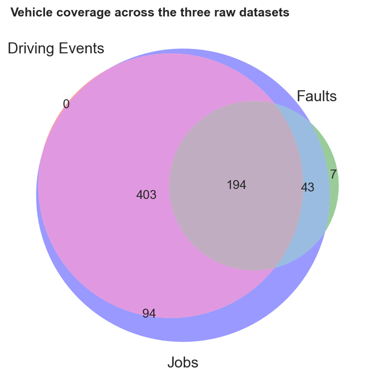
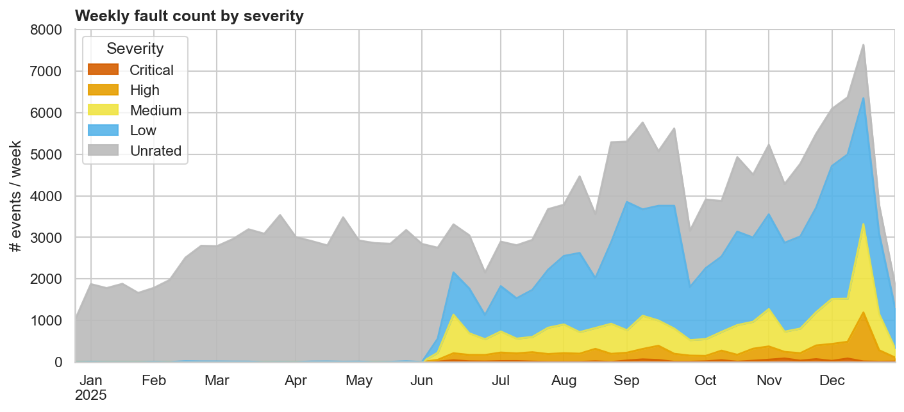
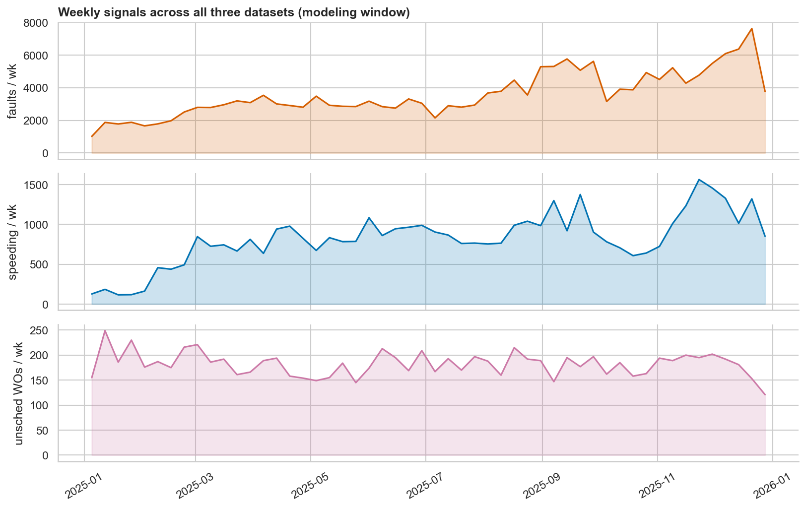
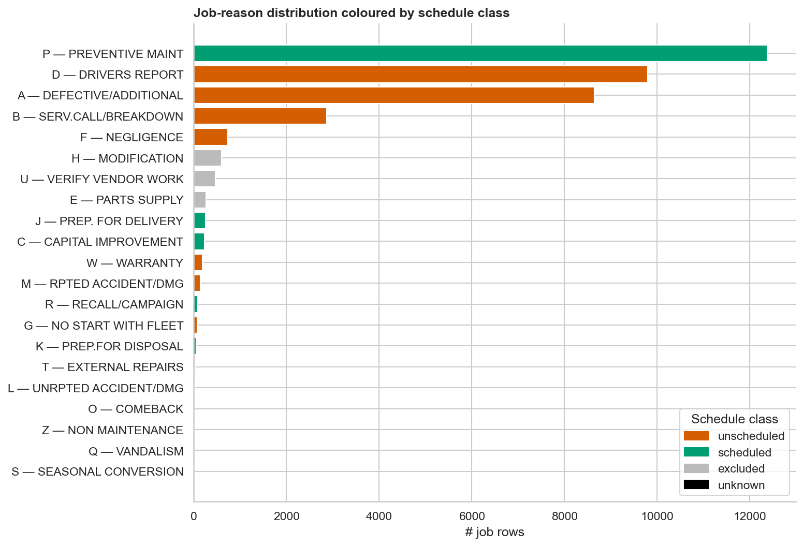
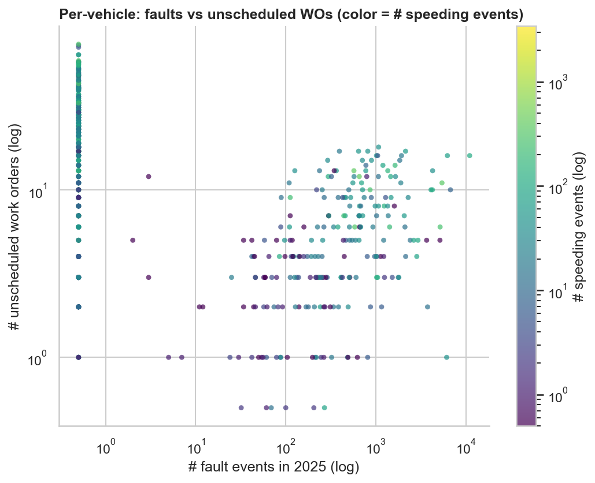
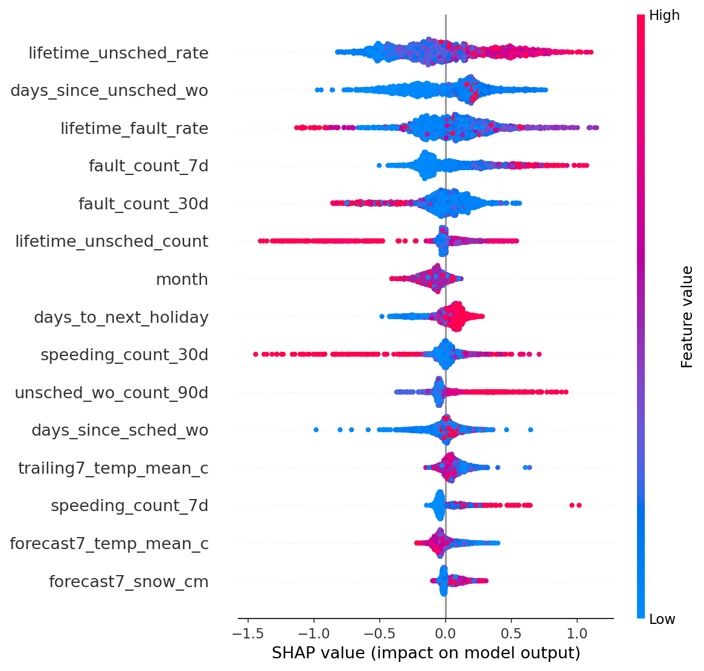

# Toronto Fleet — 7-day Unscheduled Repair Prediction

A take-home assignment for the Data Specialist position at the City of
Toronto Fleet Services Division. The brief asks for two things: an
exploratory data analysis of the three provided datasets, and a
predictive model that estimates the likelihood a vehicle will experience
an unscheduled repair event within the next 7 days, using historical
repair, fault, and driving-event data. The EDA write-up is below; the
model and its results follow it.

## How to reproduce

```bash
git clone <repo-url>
cd <repo>

python -m venv .venv
source .venv/bin/activate          # Windows: .venv\Scripts\activate
pip install -r requirements.txt

# Drop the three provided .xlsx files into data/raw/ exactly as named:
#   data/raw/Driving Events.xlsx
#   data/raw/Engine Device Fault Alerts.xlsx
#   data/raw/Job History.xlsx
# They are gitignored, so the GitHub repo does not redistribute them.

python main.py

# Optional: re-run the EDA notebook to regenerate figures in reports/figures/.
jupyter notebook notebooks/01_eda.ipynb
```

## Repository layout

```text
.
├── README.md  - This document
├── requirements.txt  - Pinned dependencies
├── main.py  - End-to-end runnable pipeline
├── config.py  - Paths, label maps, modelling constants
│
├── data/
│   ├── raw/  - Provided .xlsx files (gitignored)
│   ├── external/  - Weather, holidays (fetched on demand)
│   └── processed/  - Parquet cache + feature matrices
│
├── notebooks/
│   └── 01_eda.ipynb  - Exploratory data analysis
│
├── src/
│   ├── data_loading.py  - Read xlsx, normalise vehicle IDs, parquet cache
│   ├── data_cleaning.py  - Parse EXTRA_INFO, classify jobs, WO grain
│   ├── weather_api.py  - Open-Meteo historical-weather client
│   ├── features.py  - Per-(vehicle, day) rolling-window features
│   ├── modeling.py  - Walk-forward training and evaluation
│   └── plotting.py  - Shared matplotlib styling
│
└── reports/
    └── figures/  - PNGs referenced from this README
```

## Data

The three provided datasets describe complementary signals from the same
fleet.

| Dataset | Rows | Vehicles | Date range | Grain |
|---|---|---|---|---|
| `Driving Events.xlsx` | 43,118 | 598 | 2025-01-01 → 2025-12-30 | one speeding incident |
| `Engine Device Fault Alerts.xlsx` | 188,022 | 245 | 2025-01-01 → 2025-12-31 | one fault event |
| `Job History.xlsx` | 36,829 | 734 | 2024-05-29 → 2026-02-02 | one job line within a work order |
| Common cohort (all three) | — | 194 | — | — |

### Defining an "unscheduled repair event"

`JOB_REASON` is the field that determines whether a job was planned. The
21 codes in the data fall into three classes, which I define in
`config.py`. A job is unscheduled when the reason is a driver report,
a defective or additional item found during another job, a service call
or breakdown, negligence, a no-start, an accident with damage (reported
or unreported), a comeback, vandalism, or warranty. Scheduled covers
preventive maintenance, capital improvement, prep for delivery or
disposal, seasonal conversion, and externally-mandated recalls.
Modifications, vendor-work verification, parts supply, external repairs,
and non-maintenance jobs are excluded from both labels because they
sit outside the breakdown-versus-routine distinction.

A work order is labelled unscheduled if any of its line items is
unscheduled. The work-order grain is what matters for the prediction
question; we want to know whether the vehicle is going into the shop,
not the count of defect lines on a single visit. The collapse is in
`src.data_cleaning.workorder_events`.

### Additional data

The provided telematics signals describe what the vehicle is doing on
the road, but nothing about the conditions it's driving in. For the
purposes of this assignment, I am assuming that actual historical weather
data serves as a proxy for the 7-day forecast that would be available to
the model in a live production environment.

I fetched daily Toronto weather (temperature, precipitation, snowfall,
wind) from the free Open-Meteo Historical Weather API and cached it
under `data/external/`. No API key is required. The same data is also
available from Environment and Climate Change Canada. I also added a
small Ontario statutory-holidays lookup, since fleet utilisation differs
on and around those dates.

Three other public datasets came up while scoping this and did not make
it into the pipeline. Transport Canada vehicle recalls were too sparse
to register at the daily grain. Toronto solid-waste collection schedules
would be a useful proxy for route intensity, but joining them to specific
vehicles needs sub-fleet attribution that isn't in the extract. Toronto
Road Restrictions and 311 service requests are relevant to idling and
salt exposure, but would need per-trip GPS traces.

## Approach to EDA — scope and leakage

A conservative approach would be to restrict EDA to the training window
only, which in a production pipeline would prevent any unconscious bias
from creeping into feature engineering decisions through the analyst
having seen future data. For this assessment however, since the explicit
task was to explore the provided datasets, I conducted EDA on the full
year to give a complete and honest picture of fleet behaviour. The data
leakage concern is instead addressed at the modelling stage through
walk-forward validation, which ensures the model itself never trains on
future information regardless of what the analyst observed during
exploration.

## Exploratory Data Analysis

The full notebook is at `notebooks/01_eda.ipynb`; what follows are the
points that mattered for the modelling stage. Figures referenced below
live under `reports/figures/`.

### Data integration

The three files store `VEHICLE` with different dtypes. Driving Events
and Job History use `int64`; Fault Alerts uses a zero-padded `string`.
All IDs are six characters wide, so the loader normalises everything to
a six-character string. Without this step, roughly 5% of vehicles (the
ones whose ID starts with a zero) silently drop out of every join.

Only 194 vehicles appear in all three datasets, and that's the
modelable cohort. Another ~400 show up in Drives and Jobs but have no
fault telemetry, and roughly 150 appear in only one table. The Venn
diagram below shows the breakdown.



`UNIT_TYPE` is 100% `HEAVY DUTY`, so it offers nothing to stratify on.
`FAILURE_MODE = "0"` (54k rows) is a sentinel for telematics-device
internal events that don't carry an engine failure mode, converted to
`NaN` by the loader. Fault description and DTC code are nearly but not
perfectly one-to-one: three descriptions map to multiple codes and
thirteen codes to multiple descriptions, so a categorical feature
should pick one or the other.

### Temporal patterns

The most consequential finding came from looking at fault severity over
time. Before mid-June 2025 essentially every fault is `Unrated`; after
that, the four-level severity (Critical, High, Medium, Low) starts
populating. Whatever the rollout was, a new firmware or an enriched
fault feed, it means severity-derived features only carry signal in the
second half of the modelling window.



The same period also shows telematics volume trending upward overall.
Faults grow from around 1,500 per week in January to 6,000 per week in
November, and speeding events grow from ~150 per week to ~1,500 per
week. Unscheduled work-order opens, on the other hand, stay flat at
about 200 per week. Some of the upward drift is probably new vehicles
entering the telematics fleet rather than the existing ones becoming
busier. Raw fleet-wide rolling counts aren't directly comparable
between early and late 2025 because of it, which is why the model
features all live at the per-vehicle level.



### Labels and behaviour

The `JOB_REASON` distribution, coloured by schedule class, justifies
the mapping defined above. At the work-order grain about 82% of WOs
are labelled unscheduled, dominated by driver reports (D) and
defective-or-additional findings (A).



`EXTRA_INFO` parses cleanly into three templates with a 100% parse
rate. Only about 2.5% of incidents reference a truck-specific speed
limit; the rest carry only the posted limit. A small number of rows
report `max_speed < max_road_speed`, which means the truck did not
actually exceed the posted limit but was tagged against the
truck-specific cap. I keep those rows and flag them rather than dropping
them.

At the per-vehicle level the scatter of fault count against unscheduled
WO count (with speeding count encoded as colour) doesn't show a clean
linear shape, so any model has to combine signals rather than ride on
one.



## Predictive model

### Setup and model choice

To briefly reiterate, the task is binary classification at the
(vehicle, day) grain with a 7-day prediction horizon and a roughly 10%
positive rate. A gradient-boosted classifier is a reasonable first
choice here: it handles mixed numeric features and missing values out
of the box, fits in seconds on a panel this size, and supports a clean
SHAP explanation for the final result. The per-vehicle frequency
baseline alongside it gives a reference floor to measure lift against,
and walk-forward validation over five date-boundary folds keeps the
evaluation honest about the time-series nature of the data.

### Features

The model operates on a per-(vehicle, day) feature matrix produced by
`src.features.build_feature_matrix`. It comes out at 69,452 rows by 37
columns, with a 10.2% positive rate.

Fault counts are rolling 1, 7 and 30-day totals, plus separate windows
for high-severity and critical events (useful only after the mid-year
severity rollout), plus the number of days since the last critical
fault. Driving features are 7- and 30-day counts of speeding incidents
along with total seconds and total kilometres spent speeding in the
trailing week.

Maintenance features capture two timescales. The short-term view is
rolling 30 and 90-day counts of past unscheduled and scheduled WOs,
plus days-since-last-of-each. The long-term view is a per-vehicle
lifetime: cumulative unscheduled WO count since the start of the
modelling window, the rate over the same period, and a lifetime fault
rate. The lifetime features turned out to matter a lot, for reasons
that show up in the results section.

Calendar features are day-of-week, month, an is-weekend flag, an
is-Ontario-statutory-holiday flag, and days-to-next-holiday. Weather
features cover today's max, min and mean temperature, a trailing-7-day
aggregate of mean temperature, precipitation, snowfall, below-freezing
days and freeze-thaw days, and the same five aggregates for the
forward-looking 7-day window. That forward-looking window is the proxy
for the production forecast described above.

All rolling windows look strictly at data before `t`. The only columns
that look forward are the `forecast7_*` weather aggregates.

### Modelling

The target is 1 if a vehicle has any unscheduled work order opened in
`(t, t+7d]`, else 0. Splits are walk-forward at calendar-day
boundaries, five folds total, implemented in
`src.modeling.walk_forward_splits`. Fold k trains on everything
before its test window and tests on the next ~60-day slice. No single
calendar day is shared between train and test, which avoids a
leakage issue you can get from the off-the-shelf `TimeSeriesSplit` on a
panel sorted by date.

The model itself is a `HistGradientBoostingClassifier` with 300
iterations, learning rate 0.05, max depth 6, min samples leaf 50, and
L2 regularisation of 1.0. The reference baseline is a per-vehicle
frequency model: each test row is predicted as the fraction of
training-window days on which that vehicle had an unscheduled WO in
the next 7 days, with previously-unseen vehicles falling back to the
fleet base rate. The metrics reported are ROC-AUC, PR-AUC, and Brier
score.

### Results

| Model | ROC-AUC | PR-AUC | Brier |
|---|---|---|---|
| Per-vehicle frequency baseline | 0.637 ± 0.022 | 0.145 ± 0.017 | 0.091 ± 0.003 |
| HistGradientBoostingClassifier | 0.609 ± 0.016 | 0.149 ± 0.008 | 0.094 ± 0.005 |

Mean ± std across the 5 walk-forward folds. The per-fold breakdown is
in `data/processed/metrics_per_fold.csv`.

The GBM picks up a small PR-AUC gain but trails on ROC-AUC and Brier.
Both models clear the 10.2% fleet base rate comfortably.

The more interesting question is why the GBM doesn't decisively beat
the baseline. The SHAP summary below makes it visible. The top three
features are `lifetime_unsched_rate`, `days_since_unsched_wo`, and
`lifetime_fault_rate`, all of which encode per-vehicle history. Recent
fault counts and seasonal effects do contribute, but their
contributions are an order of magnitude smaller than the per-vehicle
prior. Vehicle history dominates the 7-day signal, and the engineered
telematics and weather features add only marginal lift on top.



## Assumptions and limitations

The model only covers the 194 vehicles common to all three datasets.
Generalising to the full 5,000+ vehicle fleet would need broader
telematics coverage or explicit imputation of the missing signal.

The unscheduled definition is the per-code mapping above. The placement
of warranty (W) and recall (R) work is the most defensible-but-arguable
part of that mapping, and a sensitivity study on it would be useful.

As mentioned in the data section above, for the purposes of this
assignment I am assuming that actual historical weather data serves as
a proxy for the 7-day forecast that would be available to the model in
a live production environment. Beyond that, the mid-year onset of
severity tagging means model performance is probably better in the
late-year folds than the early ones, and the reported numbers are
averages across all five.

## Recommendations and future work

The most useful thing the model is telling us is that the fleet needs
broader telematics coverage. Only 194 of the City's 5,000-plus
heavy-duty units are in the common cohort, and SHAP shows the model is
bottlenecked on the per-vehicle prior. Bringing more vehicles into the
fault and driving-events feeds would help the model more than any
further feature engineering on the current cohort.

The second move I'd consider is extending the prediction horizon.
Weather, freeze-thaw cycles, and component wear are mechanisms that
take longer than seven days to manifest as breakdowns. The same feature
set evaluated at 30 or 60 days would likely show more lift from those
features.

Two smaller directions sit beneath those. There is per-vehicle context
that isn't in the provided extract but lives in the FMIS, things like
vehicle age, odometer reading, model year, and replacement cost. Even
basic asset attributes would likely discriminate better than event
counts alone. Beyond that, the schedule-class mapping itself deserves a
sensitivity pass; warranty work is technically unplanned from the
fleet's point of view but is initiated by the manufacturer rather than
by a breakdown, and could reasonably be excluded.

Operationally, the predicted probability can be thresholded into a
weekly "top-N vehicles to inspect" list, with SHAP providing a
per-vehicle explanation alongside each alert. The threshold should be
tuned to the shop's actual capacity rather than to a fixed statistical
target.
